# Rain City: Vancouver

**[Play in your browser](https://arrypandher.github.io/rain-city-vancouver/)** · [Controls](#controls) · [Credits](THIRD_PARTY.md) · [Verification](docs/PLAYTEST.md)

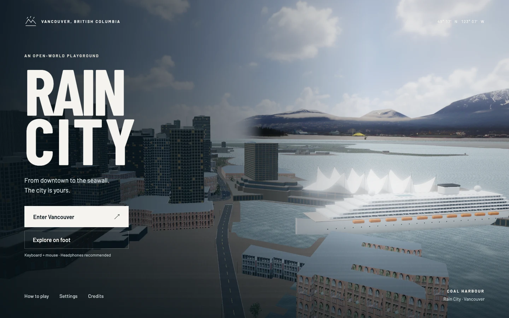

An original open-world Vancouver playground by Arry Pandher. Drive a detailed concept car through downtown, get out and walk, take a bike around Stanley Park, or try three weapons in target practice.

Real OpenStreetMap streets and footprints cover downtown, Stanley Park, East Vancouver and the Second Narrows crossing. Explore Canada Place, Robson Square, Granville Street, Gastown, English Bay, Science World, Cambie Bridge, the Ironworkers Memorial crossing and more.

This is a substantial independent browser prototype. It is not a full AAA game, a surveyed city reconstruction, or a Rockstar product. Architecture, characters, traffic and landmark models remain stylized and approximate.

The latest exterior pass restores the missing PwC Place tower, gives Fairmont Waterfront a light-admitting canopy roof, and batches terrain without reducing its detail. [Changes, gameplay evidence and remaining limitations](docs/PWC-CANOPY-TERRAIN.md). The previous pass added [mapped Robson garden stairs and the Fairmont hotel](docs/ROBSON-GARDEN-HOTEL.md).

## Play

Use a desktop browser with WebGL 2, a keyboard and a mouse. Choose **Enter Vancouver** to drive or **Explore on foot**. Click the game to capture the mouse; Escape releases it. The first load prepares the city and shaders. Balanced graphics is recommended for laptops. Settings include High and Performance modes, Pacific daylight, golden hour, rain and night. M opens fast travel and activities.

## Controls

| Action | Control |
|---|---|
| Move / accelerate / steer | WASD or arrow keys |
| Look | Mouse |
| Enter / exit vehicle | E (slow down first) |
| Sprint / full throttle | Shift |
| Jump / handbrake | Space |
| Bring a car / bike | V / B |
| Equip pistol / carbine / shotgun | 1 / 2 / 3, on foot |
| Aim / fire | Right / left mouse |
| Reload / recover vehicle | R |
| Holster | Q |
| Camera | C |
| Map and activities | M |
| Photo mode | P; WASD move, Q/E height, Enter save |
| Weather / horn | T / H |
| Pause / release mouse | Escape |

Progress and preferences are saved in this browser. Four optional activities: Harbour Run, Seawall Escape, Bridge Runner and Target Practice.

## Run locally

Node.js 22 recommended.

```sh
npm ci
npm run dev
```

Open http://127.0.0.1:5178/. Build with `npm run build`, run simulation tests with `npm test`, and preview the built game with `npm run preview` at http://127.0.0.1:4178/. Append `?debug=1` to display performance counters. A developer API is available as `window.rainCity` for reproducible local checks.

GitHub Actions builds and deploys `main` to GitHub Pages. No service keys or paid hosting required. Runtime assets are served with the game; geographic data is not fetched from Overpass during play.

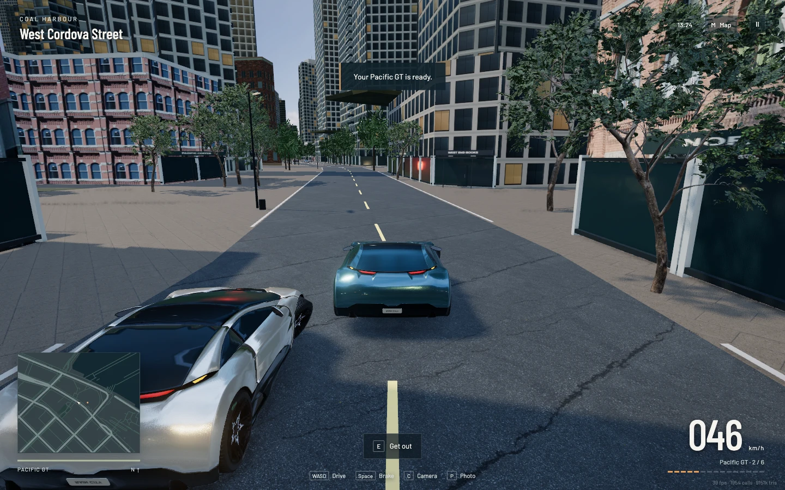

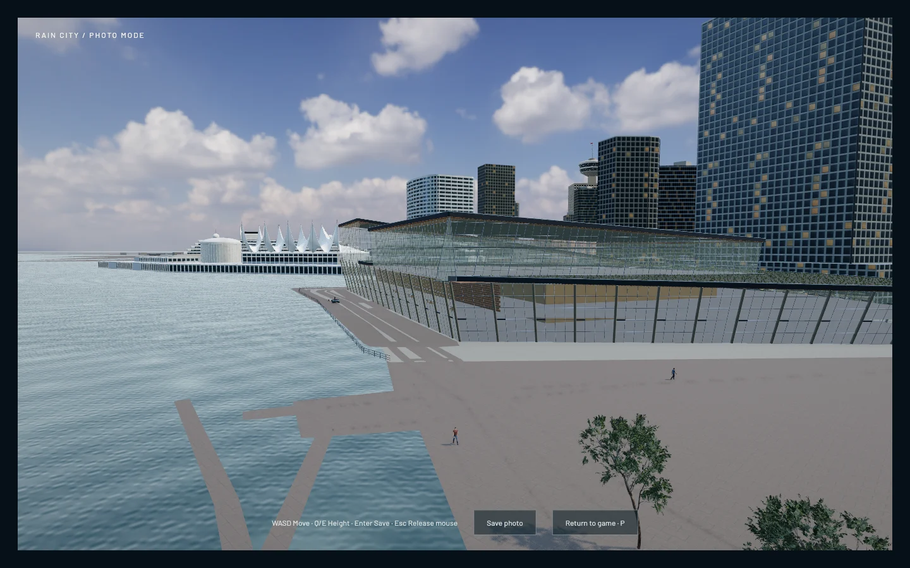

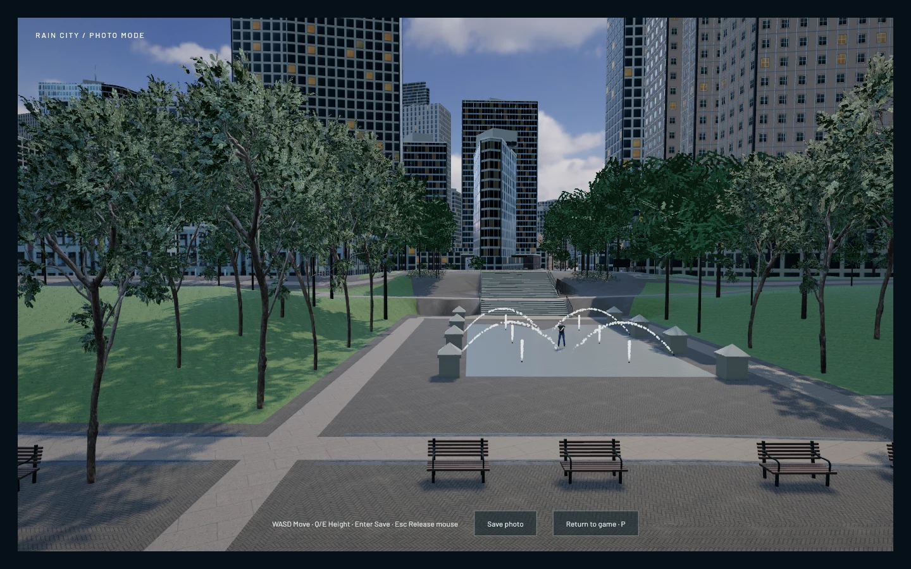

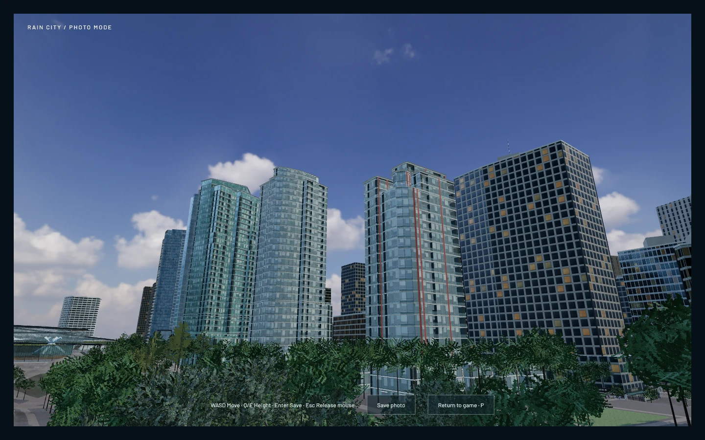

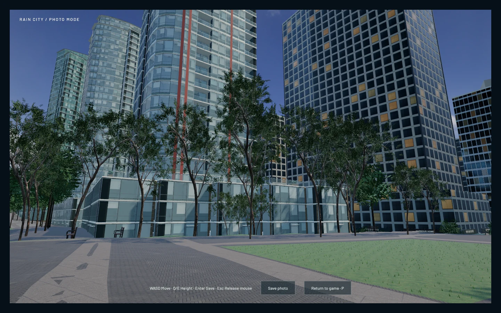

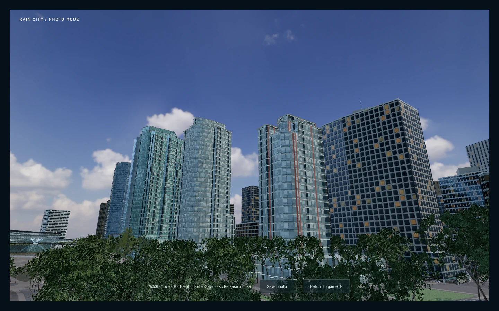

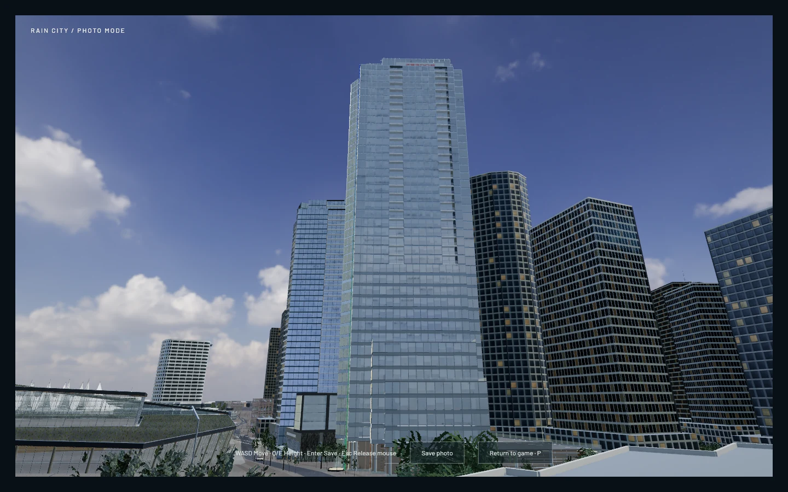

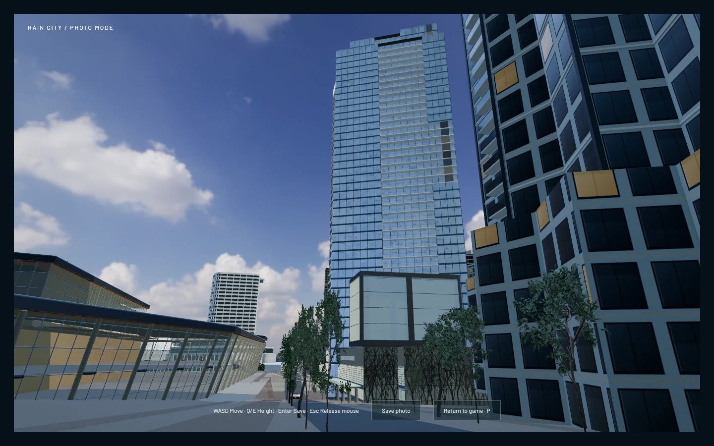

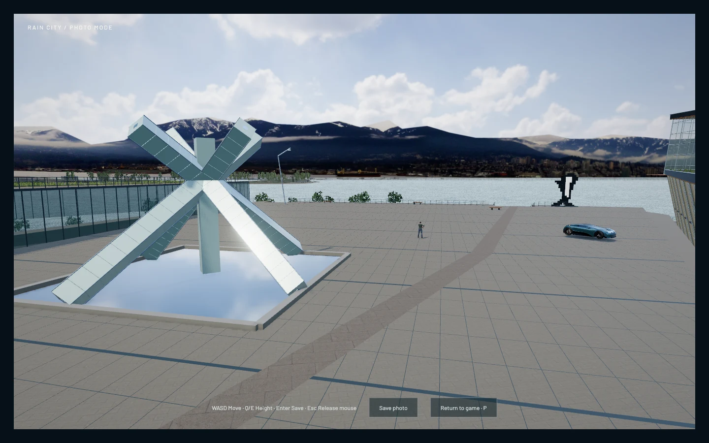

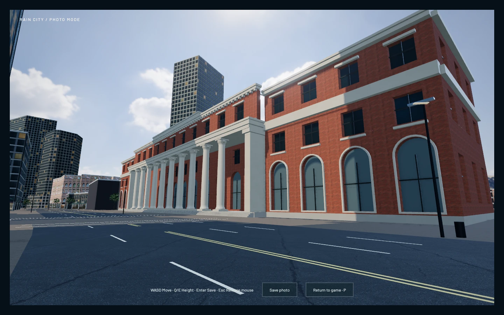

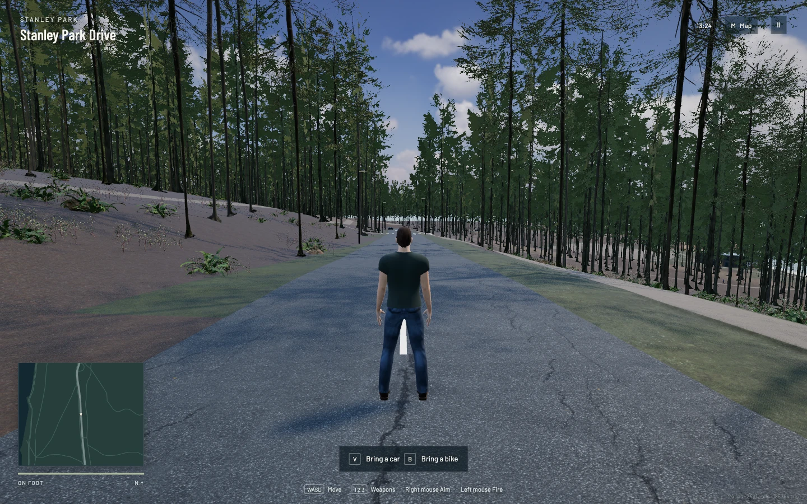

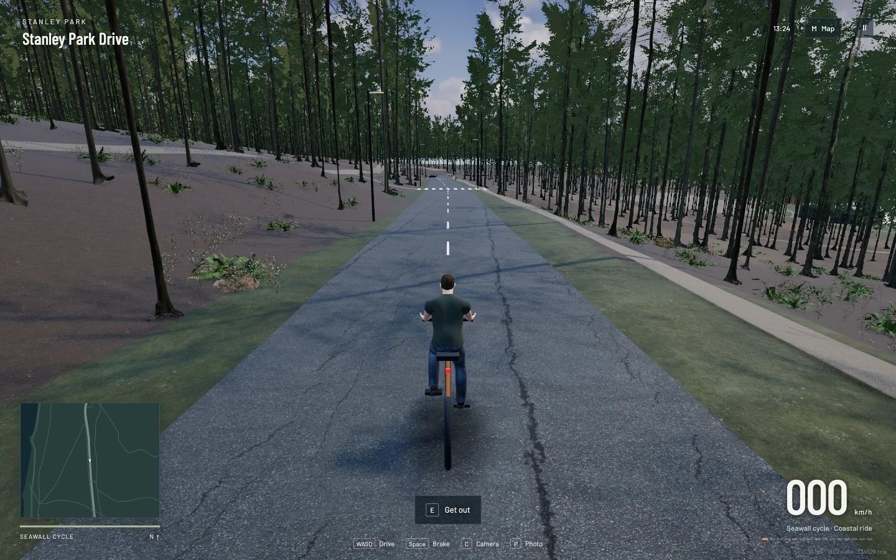

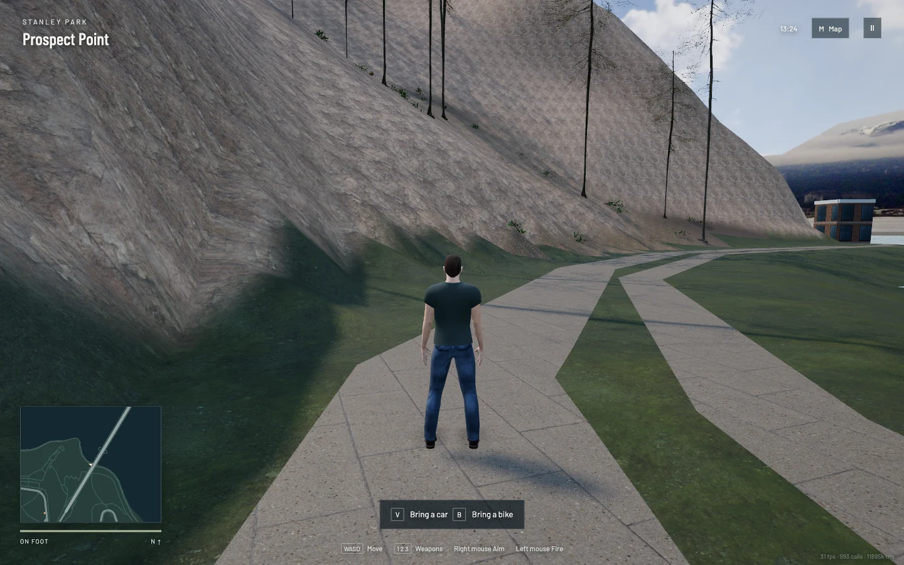

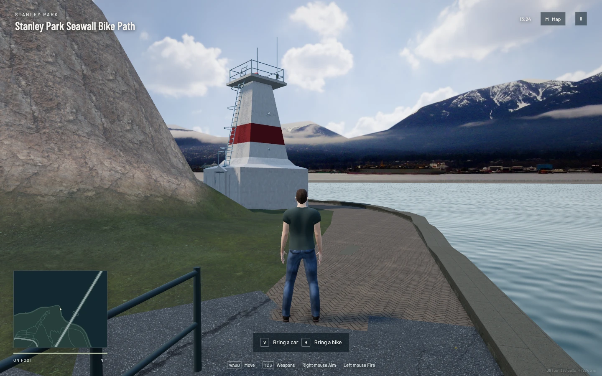

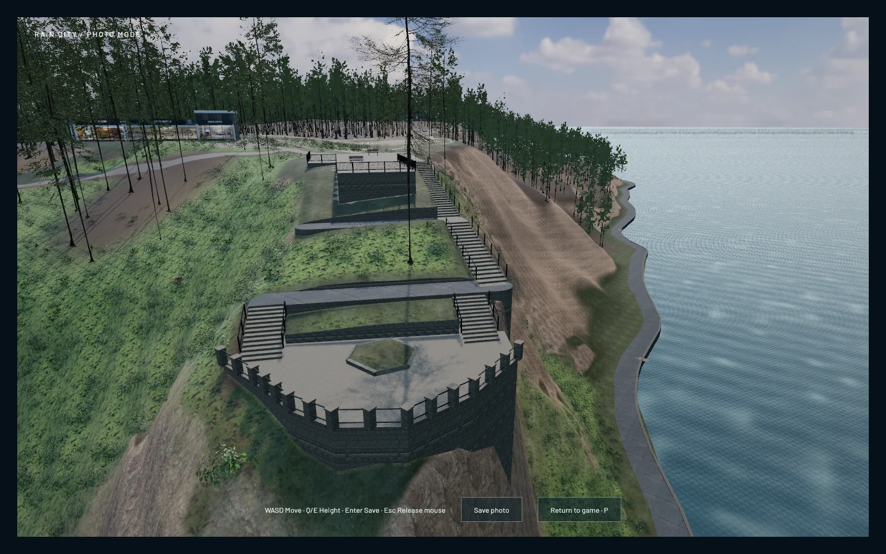

Actual game captures; scene assets and photography credited below.

## Technology and assets

Three.js, TypeScript and Vite. Chunked geometry, PBR road and ground photography, HDR sky/environment lighting, animated water, sun shadows, contact occlusion, bloom, licensed detailed vehicle assets, 12 geographically placed Vancouver landmark models with metre-scaled photographic brick, distinct stone/terracotta/concrete responses and subtle masonry joints ([sources and limits](docs/sources/landmark-surfaces.md)), a reference-guided Harbour Green Park with terraced lawns, the Bute Street spray fountain, connected stairs and waterfront paths ([sources and limits](docs/sources/harbour-green.md)), three original Harbour Green tower exteriors with mapped stepped outlines, recessed glass, balconies and park-edge podiums ([sources and limits](docs/sources/harbour-towers.md)), an original Rogers Tower with mapped stepped masses, balcony recesses, reflective glass and the interpreted Light Art outdoor pool/mist feature ([sources and limits](docs/sources/rogers-tower.md)), an original Fairmont Pacific Rim with mapped stepped masses, deep balconies, blue curtain walls, scenery rooms and its stone/glass/metal podium ([sources and limits](docs/sources/fairmont-pacific-rim.md)), an explorable Jack Poole Plaza with the Olympic cauldron, reflective basin, interpreted Digital Orca, café roof garden, mapped stairs and connected waterfront levels ([sources and limits](docs/sources/jack-poole-plaza.md)), an original Convention Centre West with sloping planted roofs, leaning glazing, timber overhangs, scenery interiors and a mapped walkable/cyclable waterfront ([sources and limits](docs/sources/convention-centre.md)), an original concrete-and-recessed-glass Arthur Erickson Place with a local scene reflection for its basin, a reference-guided Law Courts with a glazed space-frame roof and an explorable Robson Square roof garden, photographed shop interiors, PBR curtain walls, photographic heritage façades and North Shore horizon, detailed trees, a textured rigged protagonist with blended walking/running animations, two clothed rigged pedestrian templates with varied appearance, mapped lane counts/one-way directions, separately mapped sidewalks and crossings, mapped building-use/height/roof tags, pitched house roofs with photographed wood and tile materials, and procedural architecture. Geographic accuracy and scene detail continue to improve. Stanley Park uses mapped woodland boundaries, two conifer shapes with close geometry and depth-layered middle foliage, photographed forest soil and leaf litter, and nearby ferns, shrubs, nettles, moss, rocks and stumps. Prospect Point has an original reference-guided lighthouse with a timed red beacon; 3.23 km of mapped northern/western seawall carries photographed masonry, joined asphalt/herringbone paving and a corrected ocean edge ([sources and limits](docs/sources/prospect-seawall.md)). The upper Prospect lookout now has map-derived concrete terraces, walkable steps, railings and a lower viewing court ([sources and limits](docs/sources/prospect-lookout.md)). The lighthouse forecourt has a continuous walking/paving surface, a retaining bank, slope-oriented broadleaf clusters and photographed leaf cover ([source and limits](docs/sources/prospect-bank.md)). Steep coastal ground blends photographed rock through world-space projection; spatial foliage batches let the renderer cull offscreen groups independently. Middle conifers retain real wood and branch-shaped foliage slices with normal lighting, reducing each to about 3,300–3,970 triangles; selection accounts for cliff elevation and photo-camera movement ([method and limits](docs/sources/stanley-forest.md#layered-middle-distance-foliage)). City public-tree records guide street-tree locations, heights and species. Nearby broadleaf trees retain the source leaf surfaces with corrected winding, separate near/medium meshes and individual tree culling ([source and limits](docs/sources/street-trees.md)). Stanley Park has contour-derived hills, level lakes and graded roads; one terrain surface grounds walking, vehicles, trees and buildings. The City contours are approximate 2002 data, with documented road and shoreline interpretation ([method and limits](docs/sources/stanley-terrain.md)).

Code: MIT. Map database: ODbL, © OpenStreetMap contributors. City public-tree inventory and source contours: Open Government Licence – Vancouver; the combined terrain derivative retains both City and OSM attribution under ODbL. Poly Haven and ambientCG materials/models and CharacterCreator/MakeHuman generated character data: CC0. Vancouver photographs and derivatives: CC BY-SA 3.0/4.0. Codriver landmark models: CC BY 4.0. Car Concept: Eric Chadwick / Darmstadt Graphics Group GmbH, CC BY 4.0, based on Unity Fan’s CC0 source. See [THIRD_PARTY.md](THIRD_PARTY.md) and [asset manifest](public/asset-manifest.json) for exact sources and modifications.

The broadleaf canopy implementation and its current limitations are documented in [layered foliage source notes](docs/sources/broadleaf-volume.md).
