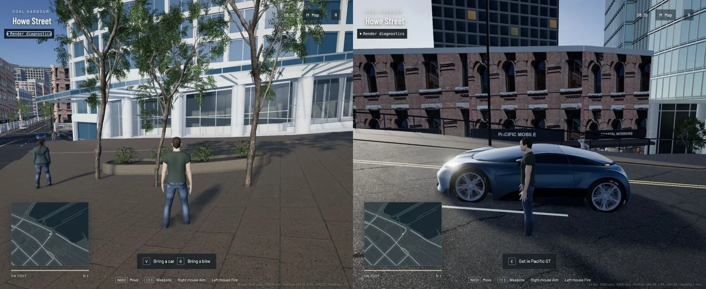

# Howe arrival court and coherent wheel finish

The active target is one or two standout playable scenes, using GTA 6 as the
AAA realism reference: Canada Place/Howe first, Robson Square/Art Gallery
second, then the Ironworkers Memorial Bridge. This is an incremental checkpoint;
the complete scene is still far below that target.

## Changes

One low, curved planted island gives the Fairmont forecourt a more legible
arrival edge. Its form comes from the historical MCM exterior photograph;
the 7.85 by 2.20 m placement and 0.45 m curb are explicit estimates constrained
by the mapped driveway, road and building edges. A closed base follows the
existing grade. Rendering, foliage roots and collision share the same surfaces.
Four existing textured broadleaf instances add planting without downloading an
asset. Total addition: 5,756 triangles, 48,552 hardscape buffer bytes and at most
three draw groups. See the [source/geometry limits](sources/fairmont-waterfront.md).

The concept car's main rim was nearly black while a small pointed insert was
white metallic. Both now use a consistent satin coated-alloy finish, preserving
the actual rim/tyre/brake geometry, two material instances and existing wheel
batching. No rendering resources were added. The purpose is to reveal the whole
wheel rather than only its decorative centre. See the
[measured material values and asset tests](sources/car-tangent-repair.md).

## Native review

The final parked-car comparison uses matching player position, camera position,
yaw/pitch/FOV and daylight settings. The full rim and spokes read more coherently;
an independent reviewer agrees. Dynamic traffic and host load differ, so no
performance gain is attributed to the material change. The finish is still
somewhat uniformly pale, and brake depth/body reflections need improvement.
An initial comparison used the title-menu car rather than the same summoned-car
pose; that unmatched frame was excluded from the comparison.

Actual controls verified driving at a displayed 53 km/h, braking and exiting
beside the court. Walking reached the planter edge at (488.19,6.10,-474.02);
another second of forward input left that position unchanged. Walking around
the end reached (483.78,6.63,-478.33), confirming a usable bypass. Attempting to
summon another car at that last location reported the street crowded, so no
full hotel-driveway traversal is claimed. Source-road geometric clearance and
the existing Howe drive pass; the complete driveway route still needs native
verification.

The curb appears grounded and its form helps organize the pavement. The sparse
planting is less dense than the source's floral bed, and nearby trees still
emerge directly from paving. No gross clipping or floating island was observed.
All 517 local tests and the production build pass. Publication checks are
recorded separately against the resulting commit and bundle.

A stationary arrival-court sample, after project builds/tests finished, averaged
15.94 fps over 20.0164 seconds (319 frames) at 1021 by 839, DPR 1.35, Balanced/day.
Median frame time was 66.5 ms, p95 100 ms, p99 116.6 ms and maximum 132.6 ms;
207 frames exceeded 50 ms and nine exceeded 100 ms. The earlier public hotel
sample was a different view under possible host load, so these are not an A/B
performance comparison. This is not smooth enough for the requested scene.
The profile records substantial existing tree and shadow cost; the small island
geometry addition is not evidence of the cause. No captured runtime errors or
reflection errors were observed. Preserve visible quality while addressing this
renderer cost alongside the larger architectural replacement.

## Next scene work

Replace the visibly wrong repeated heritage wall behind the car with the actual
Granville Square Howe wing; its identity and matching photograph are now
[documented](sources/granville-square-howe-audit.md). This is a larger scene
composition defect than another small finish adjustment. Continue with local
street reflections on the vehicle, richer source-specific street composition,
animation and sustained frame pacing. Do not expand to Robson until the first
playable scene holds together.
