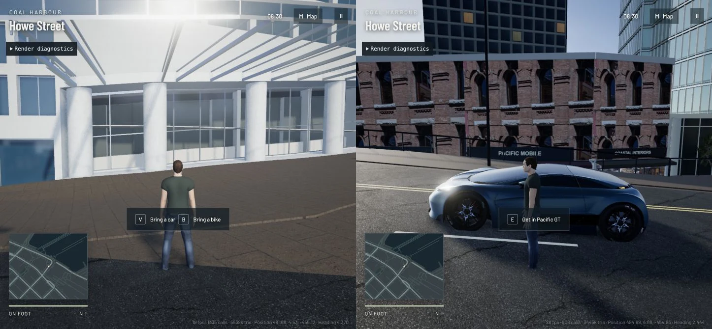

# Howe Street morning frontages

This pass continues the approved short playable Howe block beside Canada Place.
The Fairmont Waterfront and PwC frontages are reviewed together from ordinary
third-person gameplay. The full Vancouver/GTA VI realism objective remains
unachieved; this is not a trailer-quality acceptance claim.

## Architecture and lighting

The first pale backing candidate looked like covered shop windows in native
views and was rejected. The final PwC cavity has subdued rear fields 3.2 m behind
the fixed glazing and a darker entrance zone at 4.2 m, with pale side/ceiling
lining and projecting structure. Fairmont has pale returns and lower lining,
charcoal wall shoulders at 1.75 m and closed structural bay centres at 2.25 m.
The existing horizontal cap is lined and given a closed edge. These hidden
sections are restrained interpretations of visible architectural depth, not
surveyed interior reconstructions. No opening admits the player into a building.

The source exterior floors, collision glass, columns, registered footprints,
canopy plane and upper buildings remain unchanged. Fairmont totals 35,367
triangles / 71,331 vertices / 11 batches; PwC totals 23,151 triangles / 45,291
vertices / nine batches. Existing licensed maps are reused; no new model or
texture asset was downloaded.

Daylight now uses a fixed east-facing morning interpretation. The same CC0 HDR
turns 180 degrees around vertical, retaining its measured 28.288-degree sun
elevation and level horizon. Direct light, water highlight direction, sky and
environment agree. Exposure, intensity and glass parameters are unchanged.
The HUD's 08:30 is authored, not a date/time astronomical simulation. Source
calibration is recorded in the retained
[daylight metadata](sources/afternoon-daylight.json).

This is a scene-wide direction: the hotel gains direct light while PwC and the
west concourse lose it. There are no facade-specific fill lights or disabled
occluders. The hotel's columns and grille shadows read more clearly, but the
canopy can produce a strong nearly white glint at the comparison angle. The
geographically fixed North Shore photograph still has approximate lighting.

## Vehicle import and finish

The car importer discarded authored tangents after GLTFLoader selected its
normal-map convention. A car-only batching path now preserves those attributes,
compatible layouts and UV channels. The actual GLBs retain their body triangle
and draw counts. Added shared body arrays total 2,478,448 bytes across the three
runtime templates, not per car. The matched tangent-only native comparison
found no regression, but only subtle visual differences; the metallic body
appearance is not claimed solved.

A subsequent material-only step removes the decorative rims' emissive atlas
and increases the bright rim's roughness from 0.049 to 0.24. Tyres, brakes,
lights, body paint and wheel mechanics are preserved. See the
[car source/validation report](sources/car-tangent-repair.md).

## Validation status

The full local suite passed 511 checks after updating the morning-direction
fixtures. The later rim-only calibration passes all 11 applicable real-asset
car tests and the production build. Exact original tree payload and beauty
counts, off-camera shadow eligibility and canonical restoration remain tested;
the rotated shadow camera now selects 70,594 fallback-tree triangles in its
fixed fixture instead of the afternoon view's 63,240.

Third-person hotel and PwC views were near-matched to the previous checkpoint
(within approximately 0.7 m); source, cavity materials and daylight changed
together, so no quantitative contribution is assigned to an individual change.
The car tangent-only player/camera pose and lighting match exactly apart from
floating-point FOV noise. Dynamic scenery and host load differ.

The final rim view was checked at the same third-person camera. Bright spoke highlights remain; no large cosmetic gain is claimed. The runtime no longer treats the decorative rims as emitters, and the original geometry/contact silhouette remains intact. The full driving route and public release check are still pending.

Remaining realism gaps include repetitive structural detail, weak reflected
neighbourhood detail, sparse street dressing, vehicle finish, character motion
and overall frame pacing. Keep improving this same street before expanding to
the other priority regions. The [asset audit](sources/howe-asset-audit.md) found
useful open LiDAR metadata but no verified ready-made textured frontage shortcut.
