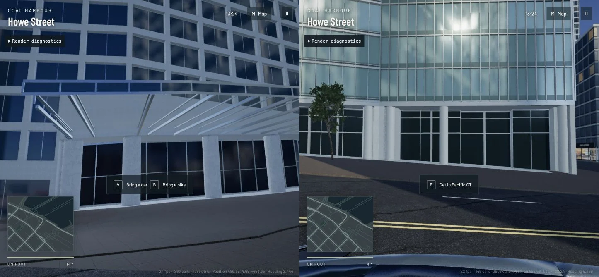

# Howe Street exterior scene

This pass concentrates on the short playable Howe approach beside Canada Place. It is a step toward Arry's requested daylight Vancouver scenes; it does not establish GTA VI/AAA fidelity or readiness for a viral gameplay clip.

## What changed

- PwC Place has two genuinely recessed exterior frontages, with a deeper entrance bay, physical side returns, soffits, columns, floor and closed rear glazing. Fairmont Waterfront has a source-fitted arcade and six substantial round piers.
- Both forecourts connect to the existing road grade. The previous generic raised-road support stopped short of the buildings, producing retaining rails and inaccessible lower frontage. Fairmont's mapped driveway also incorrectly stayed at zero height despite sharing junction nodes with the raised roads.
- Fairmont's canopy is one fitted plane over the corrected approach; its beams are straight closed prisms. The relative 6.43 m roof anchor comes from the City record, while the plane's 8.48% long-axis slope and detailed architectural sections are integration estimates. Minimum finished arcade clearance is 5.339 m. Upper hotel room rows and roof heights remain fixed. PwC's tower remains fixed.
- Collision subtracts only the modeled exterior recesses from each building footprint. Actual columns, side returns, rear glass and overhead structure remain solid. Geometry and collision share the same graded floor contracts.
- Street-level lobby reflection captures are separate from tower captures. The thin-sheet lobby shader retains dielectric specular reflection and attenuates actual closed backing scenery without a diffuse paint layer or an additional transmission render. Schlick extinction is an approximation, not a complete refraction simulation.
- Hotel room glass uses a darker opaque-room approximation with one dielectric reflection lobe. Its effective IOR of 2.1 represents a reflective coating (about 12.6% normal-incidence reflection), not uncoated bulk window glass. Mineral panels no longer have a metallic response. Day lighting and exposure are held constant for visual comparison.
- Three existing pedestrians use two clear Howe sidewalk circuits. The actor pool remains 34; movement yields to swept vehicle volumes and other bodies. No crowd pool or asset download was added.

## Source and scope

See [PwC sources](sources/pwc-place.md), [Fairmont sources](sources/fairmont-waterfront.md), [hotel apron audit](sources/fairmont-apron.md), and [pedestrian routes](sources/howe-pedestrians.md). Existing OSM, City open-data and CC0 texture attribution remains applicable. Reference photographs are not distributed as game assets. No purchases, new browser tabs, gameplay interiors or photo mode were introduced.

## Verification

All **502 tests**, TypeScript checking and the production build pass. Tests cover shader blending, actual geometry ray intersections, graded floor/pavement contacts, column clearances, source boundaries, both former road-to-building barriers, rear-wall/ceiling collision, unchanged road heights, and pedestrian routing/yielding. Two old tests assumed the newly filled hotel forecourt was still a deep drop; they now check a source-identical remaining retaining edge outside both additions. The drop thresholds were not relaxed.

The approach retains its existing limits: less than 3 cm centroid interpolation error, normal Y above 0.8, fewer than 60,000 triangles and at most four batches. Final Fairmont geometry is 33,849 triangles / 68,295 vertices / nine batches. This is added architectural work, not a claim of reduced whole-scene render cost.

In the existing Codex browser tab, ordinary keyboard input walked from the Canada Place landing (486.65, 4.68, −453.35) beneath the canopy to (467.87, 5.17, −460.05), and traversed Howe to (455.58, 1.31, −422.24). The graded candidate also reached the PwC rear glazing at (474.41, 1.32, −403.43); its floor/collision were unchanged by the final transom and hotel-roof corrections. Entered the Pacific GT, drove north along Howe at a displayed 58 km/h, braked to zero near (493.43, 6.08, −470.43), exited, walked and fired the pistol (15 → 14 rounds), then holstered. The separate hotel service-drive curve has automated continuity checks but has **not** received a complete native vehicle traversal.

Final diagnostics show 28 successful local reflection captures, no reflection error and no captured console warnings/errors. All three Howe pedestrian assignments are walking with the unchanged pool of 34. The frontal PwC view reports 1,111 total calls / 3,836,277 triangles; its beauty pass is 712 calls / 2,056,701 triangles. These are one-frame values, not a scene-wide budget.

A quiet 20.0333-second sample at the PwC frontage recorded **517 frames, 25.81 fps**, median 33.4 ms, p95 50.1 ms, p99 66.7 ms and maximum 83.3 ms; 35 frames exceeded 50 ms, none exceeded 100 ms. Settings: 723×670, DPR 1.35, Balanced, daylight. The previous near-matched checkpoint was 26.31 fps; different traffic/timing and the slight camera-position change prevent attributing the difference to this patch. No FPS improvement is claimed.

Tested bundle: `index-BFpvMolJ.js`, 1,438,921 bytes, SHA-256 `a53681731785c2b0cf26f91ee2a5e0649bf47ae7008a46d6e4a1647127009b91`.

## Remaining acceptance work

Independent image review accepts the straight canopy, level transom and continuous approaches as bounded corrections. The lobbies still read as dark, weakly differentiated surfaces; reflected neighbouring buildings, architectural wear, prop density, vehicle finish and natural animation are insufficient. These screenshots are **not** an accepted AAA scene or an achieved complete-street brief. The candid overall assessment remains approximately **3/10** against the requested GTA VI/AAA gameplay reference.

Keep working on this same short block before expanding: improve near-field glass/backing depth and source-specific surface variation, inspect a composed but ordinary occupied street view, and reduce frame cost. Require the result to hold up during a continuous walk/drive/shoot route and a fresh quiet frame-time sample. Preserve the larger Canada Place, Robson/Art Gallery, Granville and Stanley seawall goal.
