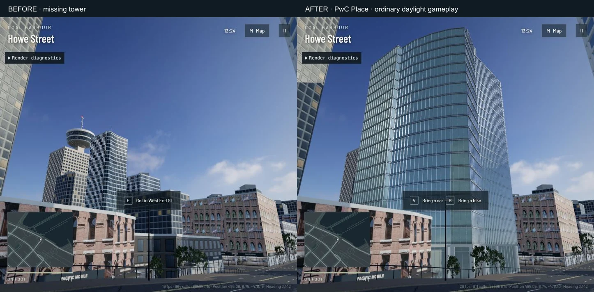

# Canada Place surroundings: PwC, canopy and terrain

2026-11-15. This checkpoint applies the asset-review lesson to one Vancouver
building: correct site identity, complete geometry and compatible materials
come before adding more catalogue assets. It remains substantially below the
requested GTA VI/AAA realism and smoothness target.

## Architecture and assets

- **PwC Place:** the old renderer used a 10 m podium height for the whole
  building, despite stale 27-floor metadata. The replacement restores the
  registered tower, stepped roof, fine vertical curtain wall, contrasting
  horizontal wing and recessed commercial base. The model uses 18,821 triangles,
  seven shared materials and one exterior reflection probe. The 83 m overall
  height and City relative roof differences are a documented synthesis with
  unresolved source discrepancies, not a construction survey.
- **Fairmont Waterfront:** a separate thin transparent canopy sheet replaces
  the opaque horizontal ceiling/roof pair. Real framing, mapped projection and
  tested head clearance remain. It adds one material batch, removes 13 triangles,
  and introduces no new textures or reflection captures.
- **Asset reuse:** actual mesh inspection rejected the existing CC0 residential
  door/window kit for PwC. Raised timber panels, letter slots and decorative sash
  trim would contradict the commercial source photograph. The new frontage uses
  original geometry and existing licensed mineral maps. No paid kit or newly
  downloaded runtime model is included.

Sources and limits: [PwC Place](sources/pwc-place.md),
[Fairmont canopy](sources/fairmont-waterfront.md),
[actual kit study](sources/pwc-entrance-kit-study.md),
[catalogue recommendations](sources/exterior-asset-options.md).

## Terrain submission

The dedicated adapter packs only audited identity-transform terrain tiles with
compatible material/shader layouts. Each tile retains its own visibility,
shadow eligibility and bounds. Unsupported multi-draw and failed setup retain
the original path; terrain, materials and view distances are unchanged.

In the exact matched hotel view, native grass submissions fell **81→4** with
117,601 triangles unchanged; forest soil fell **63→1** with 123,992 unchanged.
Those 139 fewer beauty calls are measured, not an FPS estimate. The 12 batches
cover 351 source tiles. They release the old 16.31 MB geometry buffers, retain
19.68 MB packed geometry plus 0.03 MB metadata textures, and retain zero duplicate
original buffers. This is a roughly 3.4 MB tracked allocation increase, not a RAM
saving. [Implementation and native evidence](sources/terrain-batching.md).

## Gameplay and visual checks

The same Codex tab was reused throughout. The PwC comparison used the same
camera orientation and positions within 0.10 m. A second walking-height view
checked the actual Howe frontage; it is distinct from the north/back comparison
above. Independent review accepts the massing and facade improvement and the
canopy transparency correction, while flagging flat-looking lobby glass and
uniform reflections as the strongest remaining gaps.

Walking reached beneath the Fairmont roof at (478.57,4.43,−456.25), then continued
down Howe to the PwC view at (454.69,1.21,−421.50). Pistol aim/fire/holster passed,
with 14/180 rounds after one shot. Entry into the nearby West End GT, driving
along Howe from (451.17,0.70,−416.58) to approximately (469.04,3.03,−439.35),
braking to zero and exit/continued walking all passed. The car's recorded travel
counter was 24.00; coordinate displacement is a different measure. Prospect Point
walking verified visible terrain/verge contact after batching. Captured browser
warnings/errors were empty and 26 local reflection captures completed without
a recorded reflection error.

The stationary PwC sample contained 527 frames over 20.0338 seconds: **26.31 fps**,
median 33.4 ms, p95 50.1 ms, p99 51.9 ms, max 67.6 ms, 32 frames over 50 ms and none over 100 ms.
This was 723×670 at pixel ratio 1.35, Balanced/day. There is no isolated full-frame
before/after FPS claim or sustained 1080p certification. The later streamed
Prospect forest still showed substantial load, roughly 16 fps / 24 million reported
triangles, and needs separate work.

Local evidence is retained in `artifacts/local/pwc-*`, `terrain-native-*` and
`fairmont-canopy-daylight.jpg`. Exact release, complete-suite/CI results and
public verification are recorded in the project log.

The combined local suite passed all **466 tests**. TypeScript checking and the
production build passed. The added tests cover source height precedence,
retained footprints/roof registration, real recesses and canopy clearance,
transparent-roof shadow policy, and exact terrain attributes/culling plus
atomic fallback after a simulated allocation failure.

## Next

Give PwC's lobby and Fairmont's ground arcade more visible architectural depth,
then calibrate less uniform glass against the matching source elevations.
Rebuild Granville Square and its shared parkade as separate assemblies. Continue
the four-scene scope: Canada Place, Robson/Art Gallery, Granville Street and
Stanley seawall. Animation, crowd routing and sustained performance remain open.
